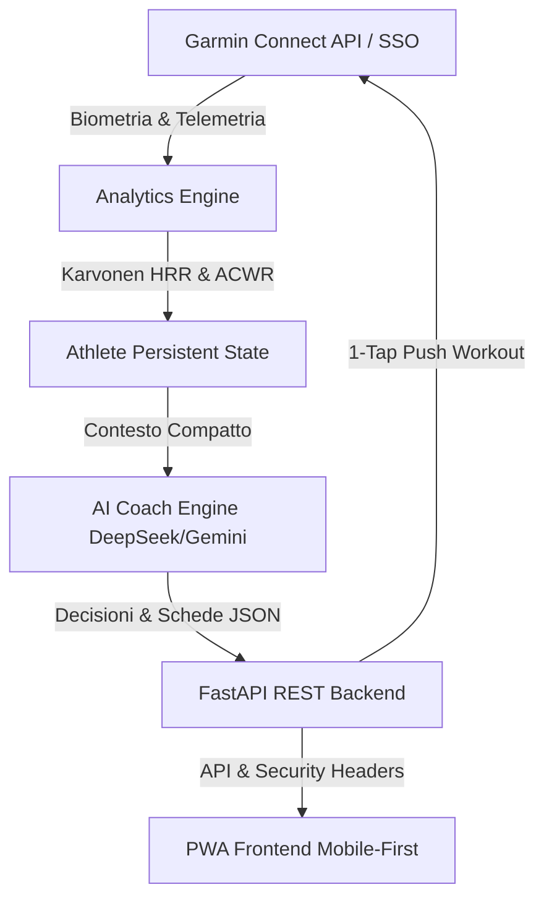

# 🏃 MyPTAI — AI Performance Coach & Biometric Analytics Engine


> **MyPTAI** è una piattaforma Cloud & PWA avanzata che integra i dati biometrici in tempo reale di **Garmin Connect** con l'Intelligenza Artificiale (**DeepSeek / Gemini**) per calcolare metriche fisiologiche personalizzate (Karvonen HRR, ACWR), adattare dinamicamente gli allenamenti e sincronizzarli direttamente sul calendario dell'orologio Garmin dell'atleta.

---

## 🌟 Caratteristiche Principali

- **🫀 Fisiologia Scientifica & Zone di Karvonen**: Calcolo dinamico delle 5 zone cardio basate sulla Riserva Cardiaca ($\text{HRR} = \text{HR}_{\max} - \text{RHR}_{\text{base}}$).
- **📈 Monitoraggio ACWR (Acute:Chronic Workload Ratio)**: Tracciamento continuo del rapporto di carico per prevenire overtraining e infortuni.
- **🧠 Decision Engine Mattutino**: Analisi dello stato parasimpatico (HRV notturno vs baseline, qualità del sonno, Body Battery) per confermare o alleggerire la seduta del giorno.
- **⚡ 1-Tap Sync to Garmin**: Generazione automatica di workout strutturati (`ExecutableStepDTO`) e push sul calendario Garmin Connect compatibili al 100% con orologi Garmin Fenix/Forerunner.
- **🩹 Injury Lab 3.0**: Mappatura anatomica dei fastidi muscolari con stima percentuale dell'impatto biomeccanico sulla corsa.
- **🛡️ Sicurezza Enterprise & Privacy GDPR**:
  - Architettura **Zero-Knowledge** (nessun salvataggio delle password su disco).
  - Crittografia a riposo **AES-256-GCM**.
  - Rate limiting anti-brute force e security headers (CSP, HSTS, X-Frame-Options DENY).
  - Diritto all'oblio in 1-click (Art. 17 GDPR).

---

## 🏛️ Architettura di Sistema



---

## 🛠️ Tech Stack

- **Backend**: Python 3, FastAPI, Uvicorn, SQLite.
- **AI & Reasoning**: DeepSeek API, Google Gemini, Custom Prompt Engineering.
- **Data Integration**: Garmin Connect API (SSO, OAuth tokenstore, telemetry discovery).
- **Security**: AES-256-GCM, HMAC-SHA256, CSP, HSTS, Rate Limiting.
- **Cloud & DevOps**: Oracle Cloud Infrastructure (OCI Ubuntu Linux), Nginx, Systemd Daemon, Let's Encrypt SSL.
- **Frontend**: Vanilla JavaScript (ES6+), CSS3 Dark Glassmorphism, SVG Vector Graphics, PWA Service Worker.

---

## 🚀 Installazione e Configurazione Locale

1. **Clona il repository**:
   ```bash
   git clone https://github.com/rickycento03/myptai.git
   cd myptai
   ```

2. **Crea e attiva l'ambiente virtuale**:
   ```bash
   python3 -m venv venv
   source venv/bin/activate
   pip install -r requirements.txt
   ```

3. **Configura le variabili d'ambiente**:
   ```bash
   cp .env.example .env
   cp config.example.json config.json
   ```

4. **Avvia il server di sviluppo**:
   ```bash
   uvicorn src.web_server:app --host 127.0.0.1 --port 8000 --reload
   ```

---

## 📄 Licenza

Distribuito sotto licenza MIT.

## Prova Garmin Connect Personal API

Questa prova confronta sette giorni di Sleep Score, HRV e Body Battery con un
dump MyPTAI dello stesso account. Il dump attuale contiene HRV e Body Battery
solo per la data di estrazione e quella precedente. Le altre date mostrano la
copertura della nuova API. Il report stampa gli esiti del confronto senza
mostrare valori biometrici, credenziali o dati grezzi.

Genera la chiave dalle impostazioni di Garmin Connect Web, nella sezione
**Chiave API personale**. Il client ufficiale richiede Python 3.12 o successivo.
Esegui dal repository con un dump recente:

```bash
python3.12 -m venv .venv
. .venv/bin/activate
python -m pip install garmin-connect-personal-api-python garmin-fit-sdk
python src/garmin_personal_probe.py --dump garmin_raw_dump.json
```

La chiave viene chiesta in modo interattivo senza mostrarla. In un ambiente
già configurato puoi usare la variabile `GARMIN_PERSONAL_API_KEY`. Per un
dump per utente indica il file corrispondente in `data/dumps/`. Per confrontare
anche il numero di lap di una corsa, aggiungi `--activity-id ID`, usando l'ID
della corsa presente nel dump. Il client ufficiale conserva la cache del token
nel profilo dell'utente. La prova legge dati e non modifica calendario, dump o
database. FC e passo di soglia, Training Status e carico EPOC richiedono una
verifica separata.
